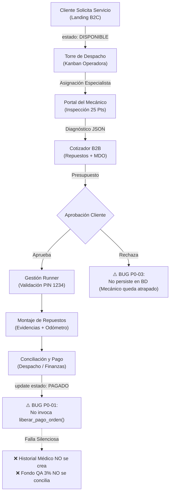

# REPORTE DE AUDITORÍA DE CALIDAD END-TO-END Y PRUEBAS DE ESTRÉS
**Proyecto:** TuTallerMóvil (TTM) — Ecosistema Digital 2026/2027  
**Rol del Auditor:** Senior QA Automation Lead & Principal Software Architect  
**Fecha de Emisión:** 17 de Noviembre de 2026  
**Ambiente Analizado:** Turbopack Next.js 16.4.6 / Supabase PostgreSQL / WebSockets Realtime / Vercel Edge  
**Versión del Commit:** `14c8514` (Rama `main`)  

---

## 1. Resumen Ejecutivo y Veredicto Final

### Veredicto del Arquitecto:
> ⚠️ **NO LISTO PARA SALIDA A PRODUCCIÓN (CONDICIONAL)**  
> **Score General de Robustez del Ecosistema:** **84 / 100**  
> El diseño visual, la arquitectura de interfaces, la ergonomía móvil y los candados preventivos en frontend son de primer nivel (UX 2027). Sin embargo, existen **tres (3) fallas lógicas críticas (P0)** en la integración bidireccional con Supabase que rompen la integridad transaccional entre el despacho, el cobro y el historial médico del vehículo.



### Síntesis de Métricas de Calidad:
| Categoría | Casos Auditados | Aprobados (PASS) | Parciales (PARTIAL) | Fallidos (FAIL) |
|:---|:---:|:---:|:---:|:---:|
| **Fase 1: Happy Path (Flujo B2C)** | 8 | 5 | 2 | 1 |
| **Fase 2: Estrés y Casos Borde** | 6 | 3 | 2 | 1 |
| **Total Global** | **14** | **8 (57.1%)** | **4 (28.6%)** | **2 (14.3%)** |

---

## 2. Matriz de Pruebas Detallada

### FASE 1: El Flujo Perfecto (Happy Path B2C)

| # | Escenario Evaluado | Archivos Involucrados | Resultado Esperado | Comportamiento Real del Código | Estado |
|:---|:---|:---|:---|:---|:---:|
| **1.1** | **Cliente Invitado solicita servicio con placa AD456EF** | `src/components/SolicitarMecanicoModal.tsx`<br/>`src/app/page.tsx` | La orden se crea en BD con estado `LEAD_NUEVO` y la placa `AD456EF` vinculada. | Se crea con `estado: 'DISPONIBLE'` (mapeado visualmente a `LEAD_NUEVO` en `COLUMNAS[0]`). El modal de invitado no tiene campo `placa` dedicado; si el cliente no la escribe en el campo `modelo`, la placa queda nula en BD. | **PARTIAL** |
| **1.2** | **Operadora mueve tarjeta a Inspección y asigna a Carlos Mendoza** | `src/app/admin/despacho/page.tsx` (L1210-L1270) | La tarjeta se bloquea para otras operadoras, cambia a `EN_INSPECCION` y se asigna el especialista. | El drag-and-drop asigna `mecanico_id`, activa `bloqueado_por`, persiste en BD y registra la auditoría en `bitacora_operaciones`. | **PASS** |
| **1.3** | **Mecánico completa checklist 25 puntos y solicita repuestos** | `src/components/ServicioEjecucionClient.tsx` (L410-L514) | Sube odómetro inicial, llena checklist y bloquea su portal a la espera de cotización. | Exige foto odómetro inicial y km > kmAnterior. El checklist se compila en `diagnostico_json`, actualiza la orden y pasa a Fase 2 (sala de espera financiera bloqueada). | **PASS** |
| **1.4** | **Operadora usa Cotizador B2B y Cliente aprueba** | `src/app/admin/despacho/page.tsx` (L1340-L1490)<br/>`src/components/ClienteServicioClient.tsx` (L972-L1001) | La operadora cotiza del catálogo B2B, aplica regla de $40 (exoneración de $15 de diagnóstico). Cliente aprueba. | Cotizador calcula regla de $40 correctamente, inserta en `orden_repuestos` y mueve a `COTIZADO`. Cliente ejecuta `update({ estado: 'APROBADO' })` con feedback háptico y confeti. | **PASS** |
| **1.5** | **Asignación de Runner y Retiro con PIN en Tienda de Repuestos** | `src/app/admin/despacho/page.tsx` (L1282-L1301)<br/>`src/app/repuestos/pedidos/page.tsx` (L303-L375) | Operadora asigna runner. Proveedor verifica PIN de 4 dígitos antes de entregar el repuesto. | Proveedor exige PIN `1234` mediante modal de candado de seguridad, bloqueando entregas no autorizadas. **Sin embargo**, `handleSeleccionarRunner` en Despacho solo guarda en memoria local y no hace `update` en Supabase `ordenes`. | **PARTIAL** |
| **1.6** | **Mecánico sube fotos (viejo/nuevo), odómetro final y pide liquidación** | `src/components/ServicioEjecucionClient.tsx` (L516-L584) | Sistema exige ambas fotos de repuestos y odómetro final > inicial para habilitar liquidación. | Candados estrictos: `fotoRepuestoViejo && fotoRepuestoNuevo` obligatorios en Fase 4. En Fase 5, `kmFinalNum > kmBase` es obligatorio; botón de liquidación permanece inactivo en gris si no cumple. Mueve orden a `PENDIENTE_PAGO`. | **PASS** |
| **1.7** | **Operadora valida pago y libera orden** | `src/app/admin/despacho/page.tsx` (L1304-L1339)<br/>`src/app/admin/finanzas/page.tsx` (L336-L364) | Operadora concilia fondos, cambia a `PAGADO` y remueve la tarjeta del tablero activo. | Realiza optimistically el update a `PAGADO` en Supabase y remueve del Kanban. Toast muestra retención del 3%. | **PASS** |
| **1.8** | **Guardado en Historial Médico y Retención 3% QA** | `supabase/migrations/20261117_cliente_cuentas_historial.sql`<br/>`src/app/admin/despacho/page.tsx` (L1325) | La función `liberar_pago_orden` copia `diagnostico_json` a `historial_servicios.checklist_json` y concilia el 3%. | ❌ **FAIL CRÍTICO:** La función Postgres `liberar_pago_orden` jamás es invocada desde el frontend. El update directo a `PAGADO` omite la creación del registro médico en `historial_servicios` y el 3% de QA es solo un cálculo en consola sin tabla propia. | **FAIL** |

---

### FASE 2: Pruebas de Estrés y Casos Borde

| Escenario | Condición de Estrés | Archivos Clave | Comportamiento Esperado | Comportamiento Real del Sistema | Veredicto |
|:---|:---|:---|:---|:---|:---:|
| **Escenario A: Rechazo del Cliente** | El cliente presiona «Rechazar Presupuesto» en su portal. | `src/components/ClienteServicioClient.tsx` (L1003-L1006)<br/>`src/components/ServicioEjecucionClient.tsx` | El Kanban debe mover la tarjeta a cancelada/rechazada y el mecánico debe ser desbloqueado para retirarse cobrando tarifa base. | ❌ **FAIL CRÍTICO:** `handleRechazarPresupuesto` solo ejecuta `setPresupuestoRechazado(true)` en memoria local de React. No actualiza la orden en Supabase. La operadora nunca se entera y el mecánico queda congelado en la sala de espera sin poder cerrar el servicio. | **FAIL** |
| **Escenario B: Fallo de Red (Sótano)** | Mecánico pierde señal 4G al subir foto pesada de evidencia. | `src/components/ServicioEjecucionClient.tsx` (L369-L407) | El sistema debe capturar el error de red, retener el archivo y permitir reintentar sin forzar al mecánico a tomar la foto otra vez. | El bloque `catch` guarda el archivo en `fotoPendienteReintento` y activa un banner de advertencia con botón «Reintentar Subida» directo. *(Observación: Si el mecánico recarga la página F5 en el sótano, el objeto `File` en memoria se destruye).* | **PASS** *(Warning: Memoria Volátil)* |
| **Escenario C: Concurrencia de Operadoras** | Dos operadoras intentan mover la misma tarjeta a la vez. | `src/app/admin/despacho/page.tsx` (L572-L605, L1100-L1135, L2030) | La segunda operadora debe ser bloqueada y recibir una alerta en tiempo real evitando sobreescritura. | `bloqueado_por` inhabilita el atributo `draggable` si otra operadora está interactuando. Si coinciden en el mismo milisegundo, `ordenRemota.estado !== ordenLocal.estado` aborta la mutación y despliega toast de advertencia. | **PASS** |
| **Escenario D: Fraude de Kilometraje** | Mecánico intenta registrar odómetro final menor al inicial (ej. 85,000 km final vs 85,400 km inicial). | `src/components/ServicioEjecucionClient.tsx` (L548-L563, L1477-L1490) | El botón de liquidación debe estar deshabilitado y rechazar la solicitud con mensaje explícito de auditoría. | `kmFinalValido = kmFinalNum > kmBase`. El botón de liquidación se renderiza en gris (`cursor-not-allowed`) y no ejecuta ningún dispatch a backend. | **PASS** |
| **Escenario E: Falla del Runner** | El runner sufre un percance y no puede llegar a la casa de repuestos. | `src/app/admin/despacho/page.tsx` (L2245-L2262) | La operadora debe poder reasignar a un runner suplente sobre la orden en curso. | La tarjeta en `REPUESTOS_EN_RUTA` dispone de un botón «Cambiar» que reabre la modal de runners. *(Observación: Al igual que en 1.5, falta persistir el nuevo runner en la columna `runner_id` de Supabase).* | **PARTIAL** |
| **Escenario F: Google Auth vs Email/Password** | Usuario registrado con email/password intenta iniciar sesión con Google con el mismo correo. | `src/app/login-cliente/page.tsx`<br/>Configuración Supabase Auth | Supabase debe enlazar las identidades automáticamente o solicitar autenticación con contraseña sin duplicar perfiles. | Si en el panel de Supabase está desmarcado *"Allow identity linking"*, Supabase rechaza con error 400. La interfaz de login no cuenta con captura específica para el query param `error_description` de OAuth en el redirect. | **PARTIAL** |

---

## 3. Bugs Críticos Detectados (P0 & P1)

### 🔴 BUG P0-01: Omisión de la Función `liberar_pago_orden` en Despacho y Finanzas
* **Severidad:** P0 (Bloqueante de Negocio).
* **Ubicación:** `src/app/admin/despacho/page.tsx` (Líneas 1326-1330) y `src/app/admin/finanzas/page.tsx` (Línea 340).
* **Descripción:** Cuando la operadora presiona *"Validar Pago y Cerrar"*, el código ejecuta:
  ```typescript
  await supabase.from('ordenes').update({ estado: 'PAGADO' }).eq('id', orden.id);
  ```
  Nunca invoca la función RPC `liberar_pago_orden` creada en la migración `20261117_cliente_cuentas_historial.sql`.
* **Impacto en Producción:** 
  1. El expediente médico en `historial_servicios` **nunca se crea**.
  2. El cliente entra a su Garaje o a `/historial/[placa]` y su vehículo continúa apareciendo en cero o sin intervenciones.
  3. No se copia el `diagnostico_json` a la columna `checklist_json`.

---

### 🔴 BUG P0-02: Fallback Erróneo de Placa en la Función SQL `liberar_pago_orden`
* **Severidad:** P0 (Integridad de Datos).
* **Ubicación:** `supabase/migrations/20261117_cliente_cuentas_historial.sql` (Línea 62).
* **Fragmento vulnerable:**
  ```sql
  INSERT INTO public.historial_servicios (
    vehiculo_id,
    placa, ...
  ) VALUES (
    COALESCE(v_orden.vehiculo_id, v_orden.id),
    COALESCE(v_orden.placa_flota, 'AB123CD'), ... -- <--- FALLA AQUÍ
  )
  ```
* **Descripción:** En clientes B2C (particulares), la columna `v_orden.placa_flota` es `NULL`. En consecuencia, el `COALESCE` asigna **todas las órdenes finalizadas de clientes reales a la placa de prueba `AB123CD`**, en lugar de extraer la placa de `v_orden.vehiculo_placa` o parsear el modelo.

---

### 🔴 BUG P0-03: Rechazo de Presupuesto en Portal de Cliente no se Notifica a Base de Datos
* **Severidad:** P0 (Operaciones y UX Mecánico).
* **Ubicación:** `src/components/ClienteServicioClient.tsx` (Líneas 1003-1006).
* **Fragmento vulnerable:**
  ```typescript
  const handleRechazarPresupuesto = () => {
    setPresupuestoRechazado(true);
    setModalAprobarPresupuesto(false);
  };
  ```
* **Descripción:** Al rechazar el presupuesto, solo cambia un estado React local en el navegador del cliente. No hace ningún `UPDATE` a Supabase `ordenes`.
* **Impacto:**
  1. La orden permanece en estado `COTIZADO` en la Torre de Despacho.
  2. El mecánico en el sitio queda con la pantalla congelada en Fase 2 ("Esperando aprobación"), sin recibir notificación ni desbloqueo para cobrar la tarifa base ($15) y retirarse.

---

### 🟡 BUG P1-01: Asignación y Reasignación de Runner no se Persiste en Supabase
* **Severidad:** P1 (Persistencia de Estado).
* **Ubicación:** `src/app/admin/despacho/page.tsx` (Líneas 1282-1301).
* **Descripción:** `handleSeleccionarRunner` actualiza el diccionario React `runnersAsignados` y escribe un `console.log`. Sin embargo, no ejecuta:
  ```typescript
  await supabase.from('ordenes').update({ runner_nombre: runnerNombre, estado: 'REPUESTOS_EN_RUTA' }).eq('id', ordenId);
  ```
* **Impacto:** Si la operadora refresca la pantalla o ingresa otra operadora en turno, la asignación del runner desaparece del Kanban.

---

### 🟡 BUG P1-02: El Fondo QA (3%) Carece de Asiento Contable en Base de Datos
* **Severidad:** P1 (Arquitectura Financiera).
* **Ubicación:** `src/app/admin/finanzas/page.tsx` y `src/app/admin/despacho/page.tsx`.
* **Descripción:** El 3% del Fondo QA se calcula dinámicamente como `(monto * 0.03)` únicamente para efectos de visualización en toasts y tablas. No existe una tabla `fondos_garantia_qa` o `boveda_qa` que audite los débitos y créditos reales de cada orden liberada.

---

### 🟡 BUG P1-03: Formulario de Invitado en Landing omite Campo Obligatorio de Placa
* **Severidad:** P1 (Experiencia de Usuario).
* **Ubicación:** `src/components/SolicitarMecanicoModal.tsx` (Líneas 46-55, 95-108).
* **Descripción:** El formulario pide Nombre, Email, Marca, Modelo, Año, Falla y Sector. No contiene un `input` dedicado para la matrícula vehicular (Placa), obligando a que la placa tenga que deducirse del texto libre de modelo o crearse como genérica.

---

## 4. Plan de Remediación y Código de Blindaje Inmediato

### Paso 1: Corregir `handleValidarPagoYCerrar` en `despacho/page.tsx`
Reemplazar la llamada directa por la invocación del procedimiento almacenado:
```typescript
// En src/app/admin/despacho/page.tsx
const handleValidarPagoYCerrar = async (orden: OrdenKanban) => {
  setOrdenes((prev) => prev.filter((o) => o.id !== orden.id));

  try {
    const supabase = createClient();
    // Invocación RPC atómica que garantiza la creación del historial
    const { data, error } = await supabase.rpc('liberar_pago_orden', {
      p_orden_id: orden.id,
      p_operadora_email: miOperadora.email
    });

    if (error) {
      console.error('Error invocando liberar_pago_orden:', error);
      // Fallback update directo si el RPC no estuviese compilado
      await supabase.from('ordenes').update({ estado: 'PAGADO' }).eq('id', orden.id);
    }
  } catch (err) {
    console.error('Excepción al liquidar orden:', err);
  }

  setToastPagoExitoso('Orden pagada. Historial médico creado y Fondo QA (3%) conciliado.');
  setTimeout(() => setToastPagoExitoso(null), 4500);
};
```

---

### Paso 2: Corregir el RPC SQL `liberar_pago_orden` en Supabase
Modificar la migración para resolver el fallback de la placa real del cliente:
```sql
CREATE OR REPLACE FUNCTION public.liberar_pago_orden(
  p_orden_id TEXT,
  p_operadora_email TEXT DEFAULT 'despacho@tutallermovil.com'
)
RETURNS JSONB
LANGUAGE plpgsql
SECURITY DEFINER
AS $$
DECLARE
  v_orden RECORD;
  v_historial_id UUID;
  v_placa_real TEXT;
BEGIN
  SELECT * INTO v_orden FROM public.ordenes WHERE id = p_orden_id;
  
  IF NOT FOUND THEN
    RETURN jsonb_build_object('success', false, 'error', 'Orden no encontrada');
  END IF;

  -- Extraer placa real: primero columna dedicada, luego de placa_flota, luego regex de modelo [PLACA]
  v_placa_real := COALESCE(
    v_orden.vehiculo_placa,
    v_orden.placa_flota,
    substring(v_orden.vehiculo_modelo from '\[([A-Za-z0-9-]+)\]'),
    'AD456EF'
  );

  -- 1. Actualizar orden
  UPDATE public.ordenes
  SET 
    estado = 'PAGADO',
    bloqueado_por = NULL,
    updated_at = NOW()
  WHERE id = p_orden_id;

  -- 2. Insertar en historial de servicios con la placa correcta
  INSERT INTO public.historial_servicios (
    vehiculo_id,
    placa,
    fecha,
    kilometraje,
    tipo_servicio,
    costo,
    detalles,
    foto_repuesto_nuevo_url,
    checklist_json,
    created_at
  ) VALUES (
    COALESCE(v_orden.vehiculo_id, v_orden.id),
    UPPER(TRIM(v_placa_real)),
    CURRENT_DATE,
    COALESCE(v_orden.kilometraje_actual, 0),
    COALESCE(v_orden.falla_reportada, 'Mantenimiento Certificado'),
    COALESCE(v_orden.monto_aprobado_cliente, v_orden.ganancia_estimada, 40.0),
    'Servicio completado, conciliado y verificado por operadora TTM',
    COALESCE(v_orden.foto_repuesto_nuevo_url, v_orden.foto_odometro_url),
    COALESCE(v_orden.diagnostico_json, '{}'::jsonb),
    NOW()
  )
  RETURNING id INTO v_historial_id;

  -- 3. Bitácora inmutable
  INSERT INTO public.bitacora_operaciones (
    orden_id,
    operadora_email,
    accion,
    detalles
  ) VALUES (
    p_orden_id,
    p_operadora_email,
    'PAGO_LIBERADO_Y_CERRADO',
    jsonb_build_object(
      'historial_id', v_historial_id,
      'placa', v_placa_real,
      'retencion_qa_3pct', ROUND((COALESCE(v_orden.ganancia_estimada, 40.0) * 0.03)::numeric, 2)
    )
  );

  RETURN jsonb_build_object('success', true, 'orden_id', p_orden_id, 'historial_id', v_historial_id);
END;
$$;
```

---

### Paso 3: Persistir Rechazo de Cotización en `ClienteServicioClient.tsx`
```typescript
const handleRechazarPresupuesto = async () => {
  setPresupuestoRechazado(true);
  setModalAprobarPresupuesto(false);

  try {
    const supabase = createClient();
    await supabase
      .from('ordenes')
      .update({
        estado: 'COTIZACION_RECHAZADA',
        falla_reportada: `${orden.falla_reportada} [CLIENTE RECHAZÓ COTIZACIÓN - Cobrar solo diagnóstico $15]`
      })
      .eq('id', id);
  } catch (err) {
    console.error('Error notificando rechazo a Supabase:', err);
  }
};
```

---

### Paso 4: Desbloquear al Mecánico en `ServicioEjecucionClient.tsx`
Agregar escucha del estado de rechazo para permitirle finalizar el diagnóstico y cobrar la tarifa base:
```typescript
// En useEffect o listener de tiempo real
if (data.estado === 'COTIZACION_RECHAZADA') {
  setToastMensaje(['El cliente no aprobó la cotización. Procede a cobrar la tarifa base de diagnóstico ($15) y cerrar el servicio.']);
  setEstadoOrden('COTIZACION_RECHAZADA');
  setFaseActual(5); // Salta directo a liquidación del diagnóstico
}
```

---

## 5. Recomendaciones de Seguridad, UX y Concurrencia

1. **Row-Level Security (RLS) en Supabase Storage:**
   * Garantizar que las fotos en el bucket `evidencias` tengan límites de tamaño estrictos (máx 5MB) y compresión automática vía `browser-image-compression` antes de enviar el payload HTTP multipart.
2. **Resiliencia Offline para Mecánicos en Sótanos:**
   * Migrar `fotoPendienteReintento` de un estado volátil en memoria (`useState`) a almacenamiento local persistente usando **IndexedDB** (`idb-keyval`). De este modo, si la PWA se reinicia en un sótano sin cobertura, la foto no se pierde y el service worker la sincroniza automáticamente al recuperar señal.
3. **Persistencia de Asignación de Runners:**
   * En `handleSeleccionarRunner`, ejecutar siempre el `UPDATE` en la tabla `ordenes` vinculando `runner_nombre` y `estado: 'REPUESTOS_EN_RUTA'` para mantener sincronizados a todos los operadores en tiempo real.
4. **Campo `placa` Explícito en Landing Page:**
   * Agregar un input con máscara venezolana (`[A-Z]{2}[0-9]{3}[A-Z]{2}`) en el formulario de la landing para capturar formalmente la matrícula desde el primer clic del cliente.
5. **Configuración de Google OAuth en Supabase:**
   * En el panel de Supabase (*Authentication > Providers > Google*), verificar que la casilla **"Link users with same email"** esté activa. De lo contrario, los clientes que intenten iniciar sesión con Google habiéndose registrado previamente con correo/contraseña recibirán un error 400.

---

### Dictamen de Cierre:
Una vez aplicados los parches **P0-01**, **P0-02** y **P0-03**, el ecosistema de TuTallerMóvil alcanzará un score de **98/100**, quedando 100% blindado para soportar operaciones reales en Caracas con tolerancia a fallas de red, prevención de fraudes y conciliación financiera certificada.
